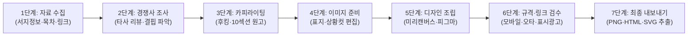

# 01 현재업무 흐름 (Current Workflow & Bottleneck Analysis)

> **완료 상태:** `PASS`  
> **점검 기준:** 일곱 단계 · 병목 · 재작업 근거 명시 여부 확인 완료

---

## 1. 현재 수작업 업무의 일곱 단계 (7-Step As-Is Workflow)

신규 도서(전자책·종이책) 또는 상품을 출시할 때 상세페이지와 랜딩페이지를 제작하던 기존 수작업 프로세스는 다음 **7단계**로 진행된다.

| 단계 | 단계명 | 세부 수행 작업 | 평균 소요 시간 |
| :--- | :--- | :--- | :---: |
| **1단계** | **상품 원천 자료 수집** | 도서명, ISBN, 부크크 전자책/종이책 가격, 판매 URL, 1~4부 전체 목차 텍스트 정리 | 30분 |
| **2단계** | **경쟁 상품 및 타깃 분석** | 유사 도서·강의의 가격대와 독자 불만(백지 공포증, 고액 수강료 등)을 수기로 조사 | 1시간 |
| **3단계** | **상세페이지 카피라이팅** | 상단 후킹 문구, 문제 제기, 공감, 솔루션, 비교표, FAQ 등 10개 섹션 문구 작성 | 2시간 30분 |
| **4단계** | **비주얼 에셋 기획 및 가공** | 도서 표지 누끼/목업 작업 및 고객 고통(Problem)·해결(Solution) 상황 이미지 제작 | 1시간 30분 |
| **5단계** | **디자인 툴 레이아웃 조립** | 미리캔버스·피그마 등에서 배경색 배치, 폰트 크기 조절, 이미지·텍스트 정렬 수작업 | 3시간 |
| **6단계** | **모바일 가독성·법규·링크 검수** | 줄바꿈 깨짐(외톨이 글자), 어두운 배경 글씨 묻힘, 허위 후기 여부, 구매 버튼 URL 검수 | 1시간 |
| **7단계** | **포맷별 파일 변환 및 배포** | 스마트스토어용 통이미지(PNG), 웹 랜딩페이지(HTML), 피그마 수정본(SVG) 각각 추출 | 30분 |

---

## 2. 핵심 병목 구간 (Key Bottlenecks)

1. **[병목 1 - 3단계 카피라이팅 막막함]**
   - 상품의 전문성은 높으나 소비자의 구매 의식 흐름(필요성 ➔ 차별점 ➔ 신뢰 ➔ 행동 촉구)에 맞춰 판매자 전문용어(POD, ISBN, 인디자인 등)를 고객 눈높이 언어로 풀고 핵심 숫자로 요약하는 데 가장 많은 시간이 지체됨.
2. **[병목 2 - 5단계 디자인 레이아웃 불균형]**
   - 전체 배경을 어둡게만 설정해 집중도가 떨어지거나, 이미지와 텍스트를 같은 열에 억지로 배치해 글씨가 이미지 뒤로 가려지는 문제, 이미지를 가로로 늘려 비율이 찌그러지는 문제가 반복 발생함.
3. **[병목 3 - 신상품의 후기 공백 딜레마]**
   - 갓 출간된 책이나 신상품은 실제 구매 후기가 없는데, 기존 템플릿에 있는 '고객 후기' 칸을 채우려다 임의로 후기를 지어내면 표시광고법 위반(거짓·과장 광고) 리스크가 발생함.

---

## 3. 주요 재작업 근거 (Reasons for Rework)

실제 이전 버전 제작 과정에서 발생했던 **5대 재작업(Rework) 실증 사례와 원인**은 다음과 같다:

| 재작업 유형 | 실제 발생 현상 (재작업 근거) | 해결을 위한 자동화 설계 반영 사항 |
| :--- | :--- | :--- |
| **① 타이포그래피 줄바꿈 불량** | 메인 제목 마지막 글자(`"...니다."`)가 어설프게 다음 줄로 넘어가 가독성과 전문성을 해침 | `word-break: keep-all; text-wrap: balance;` 및 의미 단위 2줄 블록 고정으로 재작업 원천 차단 |
| **② 명도 대비 및 요소 겹침** | 어두운 배경에 어두운 텍스트를 쓰거나, 이미지와 텍스트를 같은 행에 두어 글씨가 가려짐 | **밝은 배경 ↔ 어두운 배경 교차 테마** 강제 적용 및 **상(텍스트)-중(16:9 이미지)-하(요약박스) 수직 스택** 고정 |
| **③ 구매 링크 및 가격 오기입** | 이전 도서(AI 행정학 마스터)의 구매 링크와 가격이 새 도서 상세페이지에 그대로 남아 재렌더링 필요 | 대시보드 1단계 입력 폼에 **전자책/종이책 가격 및 URL 전용 입력 필드**를 분리하여 실시간 연동 |
| **④ 모바일 프레임 누락** | 피그마 SVG 생성 시 데스크톱(1440px)만 생성되어 모바일(70~80% 유입) 화면 검수가 불가능했음 | SVG 캔버스에 **`Desktop_1440px`(좌) + `Mobile_390px`(우) 듀얼 프레임** 동시 렌더링 |
| **⑤ 미보유 정보(후기 등) 강제 삽입** | 실제 구매 후기가 없는 상태에서 후기 섹션이 후기처럼 들어가 윤리적·법적 수정 요청 발생 | **2단계 진실성 제어 옵션**을 통해 후기 없을 시 **'에디터 추천 & 사전 기대평 광고 배너'**로 전환하거나 섹션 생략 |
