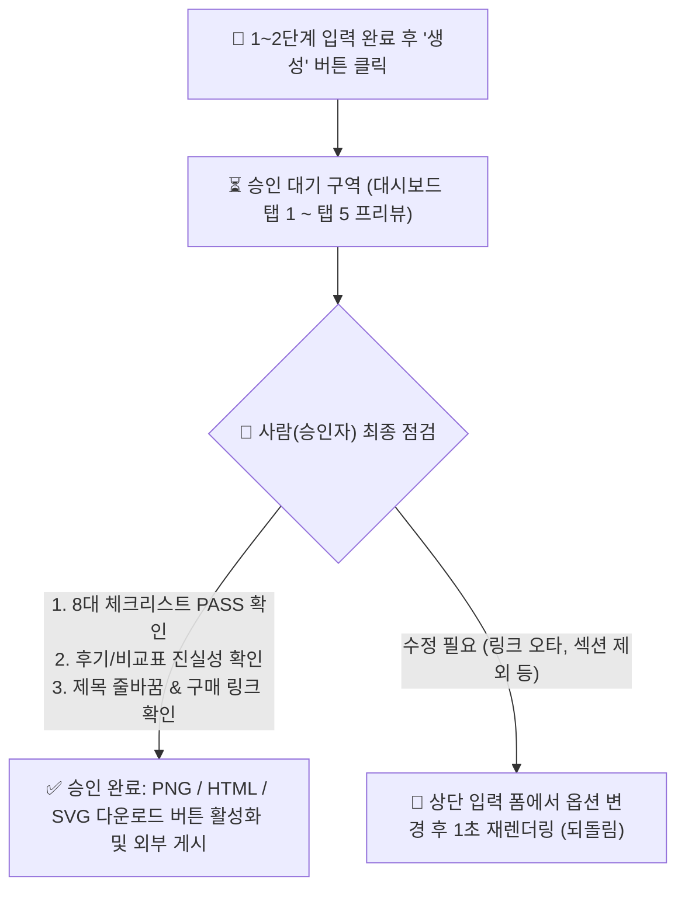

# 03 원하는 결과 (Expected Output & Staging Area)

> **완료 상태:** `PASS`  
> **점검 기준:** 형식 · 근거 · 승인 대기 구역 명시 여부 확인 완료

---

## 1. 최종 결과물의 4대 출력 형식 (Output Formats)

웹 대시보드가 생성해야 하는 결과물은 사용 목적에 따라 다음 **4가지 표준 형식**으로 출력된다.

| 번호 | 출력물 명칭 | 파일 형식 및 규격 | 활용처 및 목적 |
| :---: | :--- | :--- | :--- |
| **1** | **독립 실행형 웹 상세/랜딩페이지** | `pro_detail_page.html` (단일 HTML5 + Tailwind CSS + Base64 이미지 내장) | 자체 웹사이트, 노션 임베드, 단독 랜딩페이지 배포용 (클릭 시 구매 링크 즉시 이동) |
| **2** | **초고화질 통합 상세페이지 이미지** | `detail_page_render.png` (가로 `1200px` × 세로 가변, 2x Retina 고해상도 PNG) | 네이버 스마트스토어, 부크크, 와디즈, 크몽 등 오픈마켓 상세설명란 업로드용 |
| **3** | **피그마 듀얼 프레임 벡터 캔버스** | `figma_canvas_design.svg` (`Desktop_1440px` + `Mobile_390px` 동시 수록 SVG) | 피그마(Figma)에서 텍스트·도형·배치를 자유롭게 2차 편집하기 위한 벡터 원본 |
| **4** | **하얀돌연구소 8대 체크리스트 진단표** | 대시보드 인터랙티브 UI + 복사 시트 (`JSON` / `Markdown Text`) | 상세페이지 품질 100점 만점 채점표 및 미리캔버스 원클릭 복사용 카피 시트 |

---

## 2. 결과물 설계 근거 (Design & Marketing Rationale)

모든 결과물은 단순한 예쁜 디자인이 아니라 **실증된 마케팅 전환율 공식**과 **사용자 피드백 근거**에 의해 생성된다:

1. **[근거 1: 하얀돌연구소 스마트스토어 공식 4단계 의식 흐름]**
   - 소비자는 `① 이게 나한테 필요한가?(불편함·공감·해결책)` ➔ `② 다른 것보다 뭐가 좋은가?(상단 3초 요약·숫자의 힘·비교표)` ➔ `③ 사면 정말 만족할까?(검증된 후기 또는 에디터 추천·저자 신뢰)` ➔ `④ 왜 지금 사야 하는가?(직진형 카피·사은품·FAQ)` 순서로 구매를 결정한다.
2. **[근거 2: 시각적 집중도를 높이는 명암 교차 & 수직 스택]**
   - 전체가 어두운 배경이면 가독성이 떨어지므로 `화이트(Hero) ➔ 다크(Stats) ➔ 웜로즈 라이트(Problem) ➔ 에메랄드 라이트(Solution) ➔ 화이트(Curriculum/비교표/후기/FAQ) ➔ 다크(Offer)`로 명암을 교차한다.
   - 이미지와 텍스트를 같은 열에 두지 않고, **상단 헤드라인 ➔ 중앙 16:9 가로형 이미지(좌우 여백 확보) ➔ 하단 핵심 요약 박스**의 1단 수직 구조로 배치하여 모바일(70~80% 유입) 가독성을 극대화한다.
3. **[근거 3: 마케팅 진실성(Truth-in-Advertising) 근거]**
   - 입력값에 실제 구매 후기가 없을 때 가짜 후기를 넣지 않고 **`EDITOR'S PICK & PREVIEW (출시 기념 에디터 추천 & 사전 기대평 광고 배너)`**로 명확히 표기하여 법적·윤리적 신뢰를 지킨다.

---

## 3. 승인 대기 구역 (Approval Waiting / Staging Area)

AI가 생성한 결과물이 곧바로 외부에 게시되거나 잘못된 파일로 배포되는 것을 막기 위해, 웹 대시보드 내에 **승인 대기 구역(Staging Area)**을 둔다.

### 승인 대기 구역에서 사람이 확인하는 3가지 화면
1. **탭 1 (`🎬 하얀돌연구소 8대 체크리스트 진단기`):** 현재 설정된 상세페이지의 점수(100점 만점)와 통과(PASS)/미포함(SKIP) 항목을 먼저 확인한다.
2. **탭 5 하단 (`👁️ 실물 상세페이지 렌더링 프리뷰`):** 실제로 렌더링된 고해상도 PNG 이미지를 스크롤하며 제목 줄바꿈, 배경 대비, 후기/광고 배너 표현을 눈으로 검수한다.
3. **탭 5 상단 (`📥 3대 포맷 원클릭 내보내기`):** 검수가 끝난 후에만 다운로드 버튼(`PNG`, `HTML`, `SVG`)을 눌러 외부 스토어에 게시한다.
