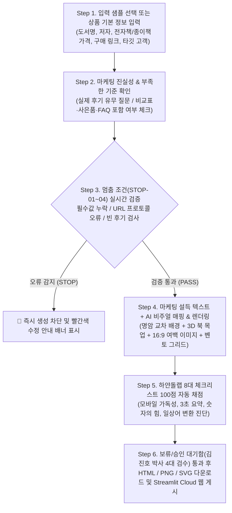

# 📘 [08] 전체 프로그램 진행 설명서 & ChatGPT / Codex 즉시 실행 마스터 가이드

> **문서 목적:** 본 문서는 **AI 마케팅 & 상세페이지·랜딩페이지 자동화 스튜디오**의 처음부터 끝까지(End-to-End) 전체 동작 원리, 무료 구현 아키텍처, 적용된 GitHub 레포지토리 및 5대 스킬, 웹 배포 현황(`https://github.com/shinhanchaplain/marketing.git`)을 총정리한 문서입니다.
> **ChatGPT 활용법:** 이 파일 전체를 복사하거나 업로드하여 **ChatGPT(또는 GPTs / Codex / Canvas)**에 넣으면, 지피티가 본 프로그램과 100% 동일한 규칙으로 상세페이지·랜딩페이지 텍스트 및 웹 코드를 생성하거나 대시보드 프로그램을 구축합니다.

---

## 1. 프로젝트 핵심 정의 (What This Program Does)

본 프로그램은 상품(도서·전자책·강의·일반 커머스 상품 등)의 **판매 전환율을 극대화하기 위한 4대 핵심 자산**을 원스톱으로 생성하는 웹 애플리케이션입니다.

1. **판매 설득 텍스트(카피라이팅) 자동 생성**
   - **5대 광고 후킹 카피**: 권위/증명형, 장벽 파괴형, 반직관/공감형, 가성비형, 스토리텔링형 헤드라인 5종
   - **10섹션 상세페이지 & 랜딩페이지 설득 원고**: 고객의 10가지 핵심 의문을 해결하는 10단계 스토리라인
   - **전문 용어 ➔ 고객 일상어 자동 치환**: `POD`, `ISBN`, `인디자인`, `프롬프트`, `페르소나` 등 어려운 판매자 언어를 고객이 3초 만에 이해하는 쉬운 혜택 언어로 변환
2. **맞춤형 마케팅 비주얼 이미지 매핑**
   - **실제 상품 입체 목업**: 도서 표지(`book_cover.jpg`)를 CSS 3D 입체 하드커버 목업으로 렌더링
   - **고객 고통 상황 컷 (`Problem`)**: 타깃 고객이 겪는 막막함(예: 백지 공포증과 스펙 고민 `scene_pain_point.jpg`)을 16:9 가로형 이미지로 좌우 여백을 살려 배치
   - **문제 해결 후 변화 컷 (`Solution`)**: 상품을 통해 문제를 해결한 미래 모습(예: AI 초고 완성 및 작가 등단 `scene_solution.jpg`)을 16:9 가로형으로 배치
3. **고전환 반응형 웹 랜딩페이지 (`pro_detail_page.html`)**
   - 전자책 즉시 구매 링크와 종이책 서점 주문 링크가 CTA 버튼에 직접 연결된 단일 배포용 웹페이지
4. **오픈마켓 등록용 상세페이지 이미지 (`detail_page_render.png`) & 피그마 시안 (`figma_canvas_design.svg`)**
   - 스마트스토어·부크크·쿠팡·와디즈 업로드용 2x Retina 초고해상도 통이미지(`PNG`) 및 피그마에서 글자·도형을 자유롭게 수정할 수 있는 데스크톱(`1440px`)+모바일(`390px`) 듀얼 벡터 파일(`SVG`)

---

## 2. 유료 AI API나 로컬 GPU 없이 **100% 무료로 동작하는 5대 기술 원리**

본 프로그램은 매달 비용이 과금되는 유료 LLM API(OpenAI API 등)나 무거운 로컬 AI 모델을 사용하지 않고도 **영구 무료**로 동작하도록 설계되었습니다.

| 번호 | 무료 구현 핵심 원리 | 상세 동작 메커니즘 | 관련 코드 파일 |
| :---: | :--- | :--- | :--- |
| **1** | **규칙 기반 마케팅 공식 엔진**<br>(Rule-Based Copywriting Engine) | 검증된 **하얀돌랩 4단계 구매 심리 공식**과 **5대 후킹 공식**, **10섹션 설득 템플릿**을 파이썬 알고리즘으로 구조화. 사용자가 입력한 변수(`상품명`, `가격`, `타깃`, `고통/해결 카피`, `구매 링크`)를 동적 바인딩(Dynamic Binding)하여 즉시 설득 원고 조립 | `hook_engine.py`<br>`detail_page_generator.py` |
| **2** | **전문 용어 치환 사전 & 정규식 비식별화**<br>(Rule Dictionary & Regex Masking) | 파이썬 매핑 사전을 통해 어려운 전문 용어를 쉬운 일상어로 자동 치환하고, 정규표현식(`re.sub(r'(?<=[가-힣])([가-힣])(?=[가-힣])', '*', name)`)으로 후기 작성자 실명(`이수진` ➔ `이*진`)을 자동 마스킹 | `detail_page_generator.py`<br>`github_design_renderer.py` |
| **3** | **조건부 적응형 블록 조립 & 멈춤 규칙**<br>(Conditional DOM & Stop-Rule Engine) | `if / else` 분기 로직으로 **구매 후기가 없으면 거짓 후기 생성을 차단**하고 `[Ad / 에디터 추천 배너]`로 자동 전환. 비교표·사은품·FAQ 체크 해제 시 해당 HTML/SVG 블록을 에러 없이 생략 | `app.py`<br>`github_design_renderer.py` |
| **4** | **GitHub 오픈소스 4종 + Tailwind CDN**<br>(Zero-Cost UI Rendering) | 유료 디자인 API 없이 브라우저가 무료로 렌더링하는 **Tailwind CSS CDN**, **Pretendard 웹폰트**, **순수 CSS 3D Perspective Transform**으로 입체 북 목업과 벤토 그리드 구현 | `github_design_renderer.py`<br>`index.html` |
| **5** | **Base64 내장 HTML & 순수 벡터 SVG 생성**<br>(Multi-Format Free Exporter) | 이미지를 Base64로 인코딩해 단일 HTML에 내장하고, 파이썬이 직접 `<svg>`, `<rect>`, `<text>` 좌표를 계산해 피그마용 벡터 파일을 무료 생성 | `pro_detail_renderer.py`<br>`build_standalone_webapp.py` |

---

## 3. 전체 프로그램 진행 단계 (Step 1 ~ Step 6 워크플로우)



### 단계별 상세 진행 내용
- **[Step 1] 원클릭 샘플 로드 또는 상품 정보 입력 (`02_입력_샘플.md`)**
  - 상단 프리셋 버튼(`샘플 1: 정상 전체 포함`, `샘플 2: 후기 없음 Ad 전환`, `샘플 3: 미니멀 생략`, `샘플 4: 오류 입력 테스트`)을 누르거나, 직접 상품명·가격·구매 링크·헤드라인을 입력합니다.
- **[Step 2] 부족한 기준 확인 및 마케팅 진실성 제어 (`04_규칙과_예외.md`)**
  - **후기 확인:** 실제 구매 후기가 있는지 먼저 확인합니다.
    - `실제 후기 있음(real)`: 후기 3건(키워드 배지, 본문, 작성자)을 입력받아 렌더링하며 실명은 `이*진` 형태로 자동 마스킹합니다.
    - `실제 후기 없음(ad_promo)`: **절대 가짜 후기를 지어내지 않고**, 합법적인 **`[Ad / 추천 포커스] 출시 기념 에디터 추천사 & 사전 기대평 배너`**로 자동 전환합니다.
    - `후기 제외(none)`: 후기 영역을 완전히 생략합니다.
  - **선택 옵션 생략:** 가치 비교표(`has_comparison`), 무료 사은품(`has_gifts`), 자주 묻는 질문(`has_faq`) 중 체크 해제된 항목은 억지로 꾸며내지 않고 결과물에서 깔끔하게 생략합니다.
- **[Step 3] 멈춤 조건(`STOP-01` ~ `STOP-04`) 실시간 안전 검증**
  - `STOP-01`: 상품명 또는 가격이 비어 있으면 생성을 멈추고 입력을 요청합니다.
  - `STOP-02`: 전자책/종이책 구매 링크가 `http://` 또는 `https://`로 시작하지 않으면 잘못된 링크 배포를 막기 위해 즉시 차단합니다.
  - `STOP-03`: 실제 후기 모드를 선택했으나 후기 텍스트가 비어 있으면 거짓 후기 생성을 막고 `ad_promo` 배너로 자동 폴백합니다.
  - `STOP-04`: 후기 작성자의 3글자 실명 노출을 감지해 `홍*동` 형태로 자동 마스킹합니다.
- **[Step 4] GitHub 4대 오픈소스 디자인 & AI 비주얼 렌더링**
  - 밝은 배경(`#FFFFFF`) ↔ 어두운 배경(`#090D16`) ↔ 웜 로즈(`#FFF1F2`) ↔ 에메랄드(`#ECFDF5`)를 교차 배치하여 집중도를 높입니다.
  - 제목은 `word-break: keep-all; text-wrap: balance;`와 2줄 블록 구조로 어설픈 줄바꿈을 방지하고, 16:9 가로형 AI 이미지(`scene_pain_point.jpg`, `scene_solution.jpg`)는 좌우 여백을 두고 상하 수직으로 배치합니다.
- **[Step 5] 하얀돌랩 8대 체크리스트 100점 실시간 진단**
  - 유튜브 강의(`https://youtu.be/C2uF4vNZLkU`) 기반 8대 기준(각 12.5점, 총 100점) 충족 여부를 자동 채점하여 리포트로 보여줍니다.
- **[Step 6] 보류/승인 대기함 검수 및 멀티 포맷 다운로드 / 웹 게시 (`03_원하는_결과.md`, `06_금지와_승인.md`)**
  - 최종 승인권자(**김진호 박사**)가 4대 검수 체크박스(링크 정상, 거짓 후기 미포함, 사은품/비교표 사실 확인, 레이아웃 여백 확인)를 모두 체크해야 `PASS` 상태가 되어 `PNG`, `HTML`, `SVG` 다운로드가 활성화됩니다.

---

## 4. 적용된 GitHub 레포지토리 (5종) 및 핵심 스킬 (5종) 총정리

### ① GitHub 레포지토리 목록
1. **본 프로젝트 공식 배포 레포지토리:** `https://github.com/shinhanchaplain/marketing.git`
   - Streamlit Community Cloud (`https://share.streamlit.io/deploy`) 연동 메인 저장소 (`Main file: app.py`, `Branch: main`)
2. **`launch-ui/launch-ui`** (`https://github.com/launch-ui/launch-ui`)
   - 상단 4단계 요약 및 1부~4부 목차(Why-What-How-After) 2x2 벤토 그리드(Bento Grid) 아키텍처
3. **`cruip/tailwind-landing-page-template`** (`https://github.com/cruip/tailwind-landing-page-template`)
   - 라이트/다크 명암 교차 섹션 및 고대비 CTA 버튼 시스템
4. **`scastiel/3d-book-mockup`** (CSS 3D Perspective Book Mockup)
   - 포토샵 없이 순수 CSS 3D 회전(`rotateY(-18deg) rotateX(4deg)`)과 그림자로 구현한 실물 도서 입체 목업
5. **`anuraghazra/github-readme-stats`** (`https://github.com/anuraghazra/github-readme-stats`)
   - `0원 출판비 / 4단계 원스톱 / ISBN 정식 발급 / 100% 작가 등록` 정량적 숫자 증명 카드

### ② 6대 핵심 스킬 (Applied Skills)
- **`[Skill 01]`** 하얀돌랩 스마트스토어 4단계 구매 심리 여정 & 8대 체크리스트 100점 자동 진단 스킬
- **`[Skill 02]`** 표시광고법 준수(거짓 후기 원천 차단 ➔ Ad 배너 전환) & 조건부 섹션 자동 생략 스킬
- **`[Skill 03]`** 판매자 전문 용어(`POD`, `ISBN`, `인디자인`, `프롬프트`) ➔ 고객 일상어 자동 치환 스킬
- **`[Skill 04]`** 한국어 헤드라인 2줄 균형 맞춤(`keep-all`, `balance`) & 16:9 가로형 이미지 좌우 여백 보존 스킬
- **`[Skill 05]`** 멀티 포맷 원클릭 패키징 스킬 (Base64 단일 `HTML` + 2x Retina `PNG` + 피그마 데스크톱/모바일 듀얼 프레임 `SVG`)
- **`[Skill 06]` 판매 페이지 URL 원클릭 재구성 (통이미지 한국어 OCR + 원본 동영상 보존 + 광고 소구점 베스트 리뷰 크롤러) (`url_analyzer.py`)**
  1. **URL 원클릭 재구성:** 판매 페이지 링크 하나만 입력하면 제목, 가격, 대표 이미지(`og:image` Base64 변환), 본문 핵심 포인트를 추출하여 어떤 상품이든 그 상품에 맞는 상세페이지(헤드라인, 고통, 해결책, 4단계 벤토 그리드, 비교표, FAQ)로 전체 재구성합니다.
  2. **통이미지 상세페이지 ➔ 텍스트 OCR 전환:** 기존 상세페이지가 통이미지(``)로 되어 있을 경우 이미지 속 한국어 텍스트를 무료 OCR 엔진(`OCR.space` 한국어 모델 및 이미지 파일 업로드 OCR)으로 추출해 선명한 웹 타이포그래피로 재정리합니다.
  3. **원본 동영상(`YouTube / Naver TV / Vimeo / MP4`) 그대로 보존:** 기존 판매 페이지에 포함된 `<iframe>` 및 `<video>` 동영상을 자동 감지하여 새로 만드는 상세페이지 중앙(`LIVE PRODUCT VIDEO` 섹션)에 손실 없이 그대로 살려서 임베드합니다.
  4. **고객 리뷰 크롤링 & 광고 소구점 베스트 3 자동 선별:** 페이지 내 리뷰를 크롤링하여 3대 광고 소구점(`✨ 가성비/실용성`, `🚀 빠른 문제해결/쉬움`, `👑 검증된 품질/신뢰도`) 키워드 점수가 가장 높은 베스트 리뷰 3건을 자동 발췌·볼드 강조하고, 작성자 실명은 `이*진` 형태로 자동 마스킹합니다. (만약 리뷰가 0건이면 거짓 후기를 만들지 않고 `ad_promo` 에디터 추천 배너로 자동 안전 전환합니다.)

---

## 5. 🤖 [ChatGPT에 그대로 복사해서 넣는 실행 프롬프트]

ChatGPT 대화창에서 새로운 상품이나 책의 상세페이지·랜딩페이지를 바로 생성하고 싶을 때 아래 코드 블록을 그대로 복사해 붙여넣으세요.

```markdown
당신은 지금부터 'AI 마케팅 & 상세페이지·랜딩페이지 자동화 스튜디오 엔진' 역할을 수행합니다.
유료 외부 도구 없이 오직 검증된 규칙 기반 마케팅 알고리즘과 GitHub 4대 오픈소스 디자인 아키텍처로 동작합니다.

[절대 준수 규칙 (00~06 명세)]
1. 거짓 후기 생성 절대 금지 (표시광고법 준수):
   - 작업을 시작할 때 내가 입력한 정보 중에 '실제 구매 후기', '비교 대상(타사/기존 방식)', '무료 사은품', 'FAQ' 기준이 있는지 먼저 확인하세요.
   - 만약 실제 구매 후기가 없다고 하거나 입력되지 않았다면, 절대 가짜 구매자 후기나 별점을 지어내지 말고 '[Ad / 추천 포커스] 출시 기념 에디터 추천사 & 사전 기대평 배너'로 전환하세요.
   - 비교표, 사은품, FAQ 등 내가 없다고 한 항목은 억지로 꾸며내지 말고 결과물에서 깔끔하게 생략하세요.
2. 멈춤 조건 (STOP-01 ~ STOP-04):
   - 필수값(상품명, 가격)이 누락되었거나 구매 링크가 http:// 또는 https://로 시작하지 않으면 결과를 생성하기 전에 먼저 수정을 요청하세요.
   - 실제 후기 작성자 이름이 3글자 실명(예: 이수진)이면 반드시 가운데 글자를 마스킹(예: 이*진)하여 비식별화하세요.
3. 하얀돌랩 4단계 구매 심리 & 8대 체크리스트 100점 공식 적용:
   - 1단계(필요성/고통 공감) ➔ 2단계(3초 핵심 요약 & 숫자의 힘 & 비교표) ➔ 3단계(키워드 강조 후기 또는 에디터 추천 배너) ➔ 4단계(사은품 티내기 & FAQ & 직진형 구매 CTA 버튼) 순서로 구성하세요.
   - 어려운 전문 용어(POD, ISBN, 인디자인, 프롬프트, 페르소나 등)는 고객이 3초 만에 이해하는 쉬운 일상어로 자동 변환하세요.
4. GitHub 4대 오픈소스 디자인 & 레이아웃 원칙:
   - 배경은 밝은 배경(#FFFFFF)과 어두운 배경(#090D16), 웜 로즈(#FFF1F2), 에메랄드(#ECFDF5)를 교차 배치하세요.
   - 모든 제목은 어설프게 1단어가 줄바꿈되지 않도록 `word-break: keep-all; text-wrap: balance;`와 깔끔한 2줄 구조를 적용하세요.
   - 이미지는 16:9 가로형 비율과 좌우 여백을 유지하며 텍스트와 겹치지 않게 상하 수직(Vertical Stack)으로 배치하세요.

[진행 순서]
먼저 나에게 아래 5가지 입력값을 요청하세요 (부족한 항목은 있는지 물어보고 없으면 생략할 것):
1. 상품/도서명 및 저자/브랜드명
2. 메인 가격(전자책 등) 및 보조 가격(종이책 등), 각각의 구매 URL 링크
3. 타깃 고객과 핵심 해결 과제 (목차 또는 4대 핵심 특장점)
4. 실제 구매 후기 보유 여부 (있으면 후기 내용, 없으면 광고/에디터 추천 배너로 자동 전환)
5. 가치 비교표 / 무료 사은품 / FAQ 포함 여부

내가 정보를 입력하면 다음 4가지를 순서대로 출력하세요:
① [5대 광고 후킹 카피] (권위형, 장벽파괴형, 공감형, 가성비형, 스토리텔링형)
② [10섹션 상세페이지 설득 원고 & AI 이미지 배치 지시서] (전문용어 ➔ 일상어 변환표 포함)
③ [하얀돌랩 8대 체크리스트 100점 만점 채점 리포트 & 최종 승인권자(김진호 박사) 4대 검수 체크리스트]
④ [독립 실행형 반응형 웹 랜딩페이지 & 상세페이지 전체 코드 (`pro_detail_page.html` - Tailwind CSS CDN 적용)]

준비가 되었다면 나에게 5가지 상품 정보 입력을 안내해 주세요!
```
